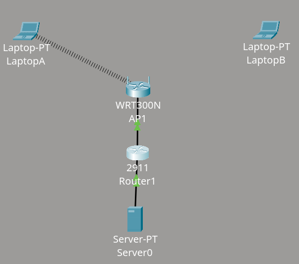
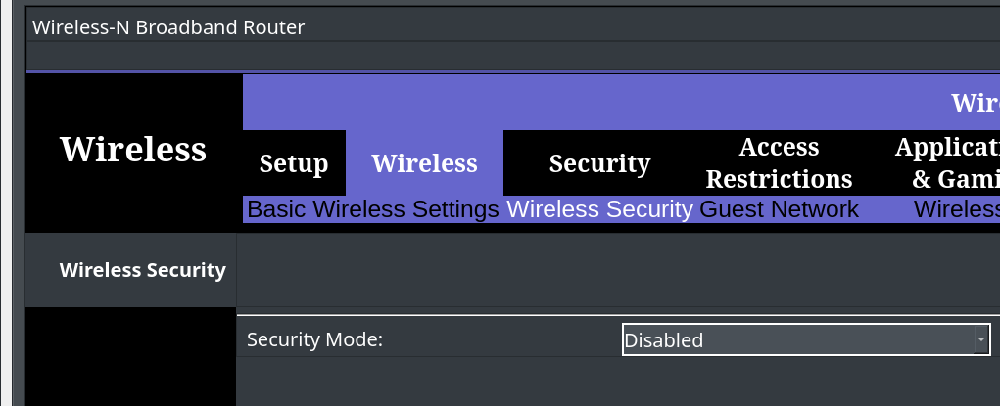
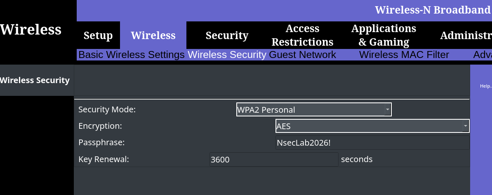

# PT05 — Harden and Monitor a Simulated WLAN

## Lab Information

- **Platform:** Cisco Packet Tracer
- **Lab type:** Wireless network security
- **File:** NSEC-PT05-wireless-hardening.pkt
- **Status:** In progress

## Objectives

- Replace open wireless access with WPA2-AES.
- Separate wireless clients from the protected wired network.
- Identify monitoring signals and IDS/IPS limitations.

---

## 1. Topology

### Devices

| Device | Role |
|---|---|
| AP1 | Wireless access point |
| Laptop-A | Authorised wireless client |
| Laptop-B | Wireless client for testing |
| Router | Network traffic control |
| Server | Protected wired server |

### Network Diagram

### IP Addressing

| Device | Interface | IP Address | Subnet |
|---|---|---|---|
| AP1 | internet | 192.168.2.2|/24 |
| AP1 | LAN | 192.168.1.1 | /24 |
| Laptop-A |Wireless-0 |192.168.0.101 |/24 |
| Laptop-B | - | - | - |
| Router | g0/0| 192.168.2.1| /24|
| Router | g0/1| 10.10.20.1 | /24 |
| Server |Fa0 | 10.10.20.10 | /24 |

---

## 2. Observe — Insecure Starting State

### Configuration

- SSID: NSEC-LAB
- Authentication mode: Open/ Disabled
- Laptop-A addressing: 192.168.0.101

### Observations

- Laptop-A was able to connect without a password.
- Laptop B was able to connect without a passowrd.

### Security Analysis

- The wireless network is open. Meaning anyone within range can connect to the wireless network.
- There is no authentication in the network.
- This creates a risk of unaothorised access and exposure of wireless traffic.

### Evidence

## 3. Protect — WPA2-AES

### Configuration

- SSID: NSEC-LAB
- Authentication: WPA2-PERSONAL 
- Encryption:AES
- Wireless security key: NsecLab2026!

### Verification

| Test | Expected Result | Actual Result |
|---|---|---|
| Laptop-A with correct key | Association succeeds | Association succeeds |
| Laptop-B with incorrect key | Association fails | Association fails|

### Security Analysis

- WPA2-AES provides encryption and authentication. 
- WPA2 controls who can connect. Once configured devices have to provide a passphrase before connecting.
- AES is an encryption standard. All traffic is encrypted.

### Evidence

## 4. Monitor — Segmentation and Detection

### Network Segmentation

Describe how the wireless client subnet is separated from the protected server subnet.

### Traffic Control

| Traffic | Expected Result | Actual Result |
|---|---|---|
| Authorised wireless service | Allowed | Allowed|
| Prohibited protected-server flow | Denied | Denied|

### Monitoring Signals

| Signal | What it may indicate |
|---|---|
| Repeated authentication failures | Possible password guessing or misconfigured clients |
| Unexpected SSID or AP identity | Possible rogue or unauthorised access point |
| Unusual association volume | Possible association flooding or abnormal client activity |

### IDS/IPS Limitations
- Cisco packet tracer is a simulation tool. It does not provide the fulll capabilities of a real wirelless IDS/IPS

## 5. Final Verification

| Requirement | Result |
|---|---|
| WPA2-AES enabled | Connection requires passphrase|
| Correct-key client associates | Lines show on the diagram once correct passphrase provided Laptop-A|
| Incorrect-key client fails | No lines on Laptop-B  |
| Wireless and protected networks separated | WLAN,AP to Router, Router to server are alll on separate networks |
| Approved service succeeds | website shows from WLAN|
| Prohibited path denied | ping from Laptop-A to web server fails|
| Three monitoring signals documented | true |
| IDS/IPS limitations documented | true |

## 6. Lessons Learned
1. Importance of wireless security. An open wirelless network allows devices to connect without authentication making the netowkr vulnerable to unauthorised access.
2. WPA2-AES:WPA2-Personal with AES improves WLAN by providing authentication and encryption.
3. Access Control Lists(ACLs): Used to  permit required traffic and block unnecessary or unauthorised traffic between network segments.
## 7. Files

- Packet Tracer file: `NSEC-PT05-wireless-hardening.pkt`
- Lab notes: `PT05-WLAN-Hardening.md`
- images: `evidence/open_wlan.png`,`evidence/closed_wlan.png`,`evidence/wllan_settings_secured.png`,`topology.png`
